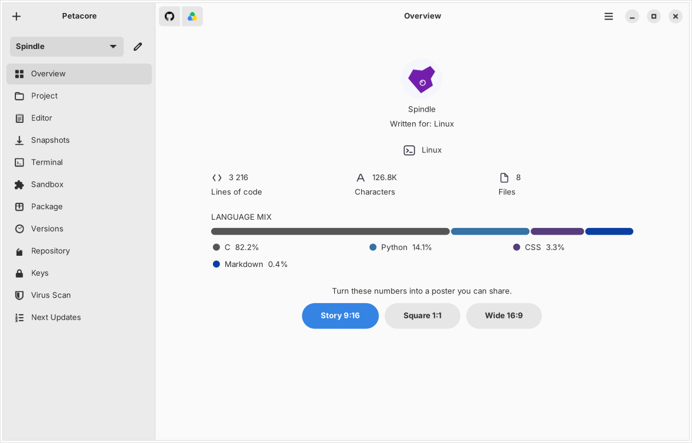

# Petacore

**The desktop workbench for building and shipping Linux software.**
Version 1.1 Beta 2 · GNOME and KDE Plasma · English, Türkçe, Deutsch, Français, 中文, Українська



## What is Petacore?

Petacore puts everything a software project needs into one window. You write and organise your code, keep restore points, build installers, sign them, publish them, back everything up and check it for viruses — without memorising a single terminal command.

It runs entirely on your own computer, works on ordinary project folders, and only talks to online services (GitHub, Google Drive, VirusTotal) when you connect them with your own accounts.

## What can I do with it?

- **Manage a project** — browse files, edit code, search, drag files in, undo mistakes.
- **Never lose work** — automatic snapshots of the whole project, one click to go back.
- **Try things safely** — run your program in a sealed Sandbox that disappears without a trace.
- **Make installers** — signed `.deb` and `.rpm` packages, no terminal needed.
- **Keep every release** — a version library where you can still read the code of any old version.
- **Publish** — your own APT repository, on your computer or your server.
- **Upload to GitHub** — push the code and publish a new version (1.0 Beta 3, 1.0 RC 1, 1.0 …) in one step.
- **Sync with Google Drive** — your other computers pick up the newest copy on their own, and nothing is ever deleted: every replaced file is kept in Backups.
- **Scan for viruses** — let VirusTotal check the project before your users install it.

## Get started

1. Unpack Petacore and run `./install.sh` in that folder (as yourself, not with sudo).
2. Open Petacore from your applications menu; a short wizard asks for your language and offers to connect GitHub and Google Drive.
3. Create your first project with the **+** button — paste a GitHub address to download an existing one, or start fresh.

📖 **Full user manual:** [docs/Petacore-User-Manual.pdf](docs/Petacore-User-Manual.pdf) — the same manual in all six languages.

---

# Technical reference

The rest of this file is the complete reference: every page, setting and safeguard, as described in the user manual.


## Contents

1. [Foreword](#1-foreword)
2. [Technical description](#2-technical-description)
3. [Installation and first start](#3-installation-and-first-start)
4. [Projects](#4-projects)
5. [Packages and releases](#5-packages-and-releases)
6. [Online services](#6-online-services)
7. [Settings](#7-settings)
8. [Security and privacy](#8-security-and-privacy)
9. [Troubleshooting](#9-troubleshooting)
10. [Keyboard shortcuts](#10-keyboard-shortcuts)
11. [Files and uninstalling](#11-files-and-uninstalling)
12. [Licence and copyright](#12-licence-and-copyright)
13. [Source layout](#13-source-layout)
14. [Development](#14-development)

## 1. Foreword

Thank you for choosing Petacore, the desktop workbench for building and shipping Linux software. Petacore keeps everything a project needs in one window: its files and code, its history, its packages and signing keys, its software repository, its copy on GitHub and on Google Drive, and a virus check before anything reaches your users.

Before you start, please read this manual carefully. It describes every part of Petacore, the settings it offers, and what it does — and never does — with your files and credentials. Knowing these will let you work faster and with complete peace of mind.

- **Developer:** Petacomm I.S.
- **Product:** Petacomm Petacore™
- **Version described:** 1.1 Beta 2
- **Project page:** github.com/petacomm/petacore

## 2. Technical description

### 2.1 General

Petacore is a native desktop application for Linux. It runs entirely on your own computer and works on ordinary project folders: nothing has to be converted, and every file stays readable by any other tool. Online services (GitHub, Google Drive, VirusTotal) are used only when you connect them, with your own accounts.

Petacore comes in two interfaces that offer the same features: one for the GNOME desktop and one for KDE Plasma. The installer picks the right one automatically, and you can switch at any time.

### 2.2 System requirements

| Item | Requirement |
|---|---|
| Operating system | Ubuntu 26.04 LTS, or another Debian- or Ubuntu-based distribution |
| Desktop | GNOME (GTK 4, libadwaita) or KDE Plasma (Qt 6, PySide6) |
| Python | 3.12 or newer |
| Disk space | About 50 MB for Petacore, plus room for snapshots and backups |
| Internet | Only for GitHub, Google Drive, VirusTotal and server connections |

### 2.3 Technical specifications

| Feature | Specification |
|---|---|
| Interface languages | English, Türkçe, Deutsch, Français, 中文, Українська |
| Package formats | .deb (Debian, Ubuntu, Mint) and .rpm (Fedora, openSUSE, RHEL) |
| Package signing | GnuPG — Ed25519 (recommended) or RSA 2048 / 3072 / 4096 |
| Version control | git; publishing to GitHub with versioned releases |
| Cloud copy | Google Drive through rclone, optionally end-to-end encrypted |
| Security scan | VirusTotal API v3, with your own key |
| Software repository | Signed APT archive, local or on your own server over SSH |
| Server connection | OpenSSH, key login only, two-factor login supported |
| Isolation | bubblewrap sandbox, network off by default |

### 2.4 Components used

Petacore relies on proven, standard tools. The installer sets them up; a missing one is reported in plain words together with the command that installs it.

| Component | Used for |
|---|---|
| git, gh | Version history; GitHub sign-in and publishing |
| rclone | Google Drive connection, synchronisation and backups |
| gnupg | Creating signing keys and signing packages and repositories |
| dpkg-dev, rpm, apt-utils | Building packages and repository indexes |
| bubblewrap | The isolated Sandbox |
| openssh-client, rsync | Server connection and publishing |
| libsecret-tools | Keeping sign-ins and API keys in the desktop keyring |
| librsvg2-bin | Saving share cards as PNG images |
| WebKitGTK (optional) | Showing Live Server previews inside the window |

## 3. Installation and first start

### 3.1 Installing Petacore

1. Unpack the Petacore archive into any folder.
2. Open a terminal in that folder and run `./install.sh` — as yourself, never with sudo. Petacore installs into your own home folder.
3. The installer recognises your desktop (GNOME or KDE Plasma). If it cannot tell, it asks which interface you want.
4. When system packages are needed, it asks for your password once and installs them with apt.
5. Petacore then appears in your applications menu, and the command `petacore` starts it from a terminal.

> **Note** — Petacore can also be installed from a .deb package. The result is the same; the installer script only adds the automatic choice of interface.

### 3.2 First start

On first start a short wizard asks for the language (your desktop's language is suggested), then offers to connect GitHub and Google Drive, and finally to create your first project. Every step can be skipped and done later from Settings.

### 3.3 The main window

On the left, the sidebar lists the pages of the active project; the project selector at its top switches between projects, and the pencil button edits the active one. At the top of the window are the GitHub button (upload to GitHub), the Google Drive button (send to Drive) and the main menu (New Project, Settings, About, Quit).


The pages depend on the kind of project. A project that targets an operating system gets Package, Keys and Sandbox; a web project gets Live Server instead, because it is neither packaged nor signed. Petacore decides this only on a clear match, so an unfamiliar project always keeps the full set.

| Page | Purpose |
|---|---|
| Overview | Figures about the project and a shareable poster |
| Project | File manager for the project folder |
| Editor | Code editor with tabs |
| Snapshots | Restore points of the whole project |
| Terminal | A shell opened in the project folder |
| Sandbox / Live Server | Trying the program safely / previewing a website |
| Package | Building signed .deb and .rpm packages |
| Versions | Release history and the code of every release |
| Repository | Signed APT repository, locally or on a server |
| Keys | GPG signing keys |
| Virus Scan | Checking the project with VirusTotal |
| Next Updates | Plans for the project |

### 3.4 Choosing the interface

Settings → Interface shows which design is in use and switches to the other one. Petacore closes and reopens in the new design; projects and settings stay as they are. If the components of the other design are missing, Petacore offers to install them.

## 4. Projects

### 4.1 Creating a project

Choose New Project from the main menu or the + button. Enter a name and the folder where the project should live.

- With a GitHub address, Petacore downloads (clones) that repository. Because that code comes from the internet, Petacore then asks whether VirusTotal should check it before you run anything in it.
- Without an address, a new local git repository is started.
- Under Encryption you may choose to keep the Google Drive copy encrypted with a 4-digit PIN, an 8-digit PIN or a passphrase of up to 4096 characters. The project on your computer stays ordinary, readable code; only the copy on Drive is encrypted — file and folder names included.

> **Note** — The encryption password is never stored. If it is lost, the encrypted copy on Drive cannot be opened by anyone, including Petacomm.

### 4.2 Editing and removing a project

The pencil button next to the project selector opens Edit Project: name, project folder, GitHub address and the installed-app folder. When an installed-app folder is set, every file you save in the Editor can be copied into the installed program at the same relative path — no terminal needed.

Remove from Petacore only takes the project off the list. No file on disk is deleted.

### 4.3 Overview

Overview shows the project at a glance: lines of code, characters, files, languages and size, the system it is written for (Linux, Windows, macOS, Web or cross-platform) and the language mix as a coloured bar.

Share Card turns these figures into a poster in three shapes — Story 9:16, Square 1:1 and Wide 16:9. The card shows only the name, the figures and the language mix, never file names or code; the name on the card can be changed if the project's own name is not for sharing.

### 4.4 Project page

The Project page is a complete file manager for the project folder. The line under the toolbar shows the git branch, how the project stands against GitHub and how many programs are running from this folder.

- Double-click opens a file in the Editor; images, audio and video open in their own viewer.
- Right-click offers Open, Rename, New Folder, Copy Path and Delete.
- Deleting is reversible: Ctrl+Z, or the undo button, brings the files back.
- Drag files in from your file manager. When names collide, you choose Replace / Merge, Keep Both or Skip.
- The search field searches the open folder; the button beside it searches the whole project. The filter limits the list to code, images, audio and video, documents or folders.
- Hold Ctrl over a file for a quick preview; Ctrl+scroll moves through long previews.
- Media Files collects every image, sound and video of the project in one place.
- The clock button opens Backups (see 6.5).

### 4.5 Editor

The Editor opens files in tabs, with syntax highlighting and the familiar keys of the micro editor (see chapter 10).

- Sections: select lines and add a section to give a part of a long file a name; the section list jumps straight to it.
- Focus mode dims every line outside the chosen section, so the part you are working on stands out. Esc clears the focus.
- Esc leaves a file. If it has unsaved changes, Petacore asks first: Esc again leaves without saving, Ctrl+S saves and leaves. The question can be turned off in Settings.
- When the project has an installed-app folder, saving offers to update the installed program as well.

### 4.6 Snapshots and autosave

A snapshot is a complete restore point of the project. Create Snapshot makes one at any time, with an optional label. Autosave makes one automatically at a set interval (10 minutes by default); the 40 most recent automatic snapshots are kept.

Restoring a snapshot first takes a safety snapshot of the current state, so a restore can itself be undone. Snapshots are stored outside the project, in your own data folder; .git, the versions folder and build leftovers are not included.

### 4.7 Terminal

The Terminal page opens your usual shell directly in the project folder.

### 4.8 Sandbox

The Sandbox runs commands in a sealed copy of your system. The real machine is read-only inside it: installing, deleting and editing only affect this throwaway session, and End Simulation removes everything without a trace.

- Try Current Project starts the Sandbox with a copy of the project.
- Install a .deb Temporarily installs a package only inside the Sandbox.
- Run App starts graphical or terminal programs from inside.
- The Sandbox has no internet by default. If something inside tries to go online, Petacore tells you and lets you allow it, keep it off, or stop asking.

> **Note** — Full isolation requires bubblewrap. Without it the page warns “NOT isolated” and shows the command that installs it.

### 4.9 Live Server

For web projects, Live Server shows the site inside Petacore without any build step and reloads it by itself whenever a file changes. F11 fills the window with the site; Esc returns.

By default the server answers only this computer. Share on the local network makes it reachable from a phone or another device on the same network and shows the address to open there. Without WebKitGTK the preview opens in your usual browser instead.

### 4.10 Next Updates

Next Updates keeps the plans for the project: a title, details, a priority (High, Normal, Someday) and attached documents. Plans can be edited, marked as done and copied. They are saved inside the project, so they travel with it, and can be synchronised to Google Drive.

## 5. Packages and releases

### 5.1 Package

The Package page builds an installer from the project: .deb for Debian, Ubuntu and Mint, .rpm for Fedora, openSUSE and RHEL. The package installs the program into /opt/<name> on the target system and adds it to the applications menu.

| Field | Meaning |
|---|---|
| Name | Package name, in lower case |
| Version | For example 1.6 or 2.0.1 |
| Maintainer | Name and e-mail address of the person responsible |
| Description | Shown by software centres and package managers |
| Licence | Chosen from the list or typed in; Compare the licences explains them |
| Signing | Signs the package with the active key (on by default) |

> **Note** — Files that carry credentials — .env, private keys, .netrc, .npmrc and similar — are always left out of the package, and Petacore tells you how many it kept back.

### 5.2 Signing keys

A GPG key is your digital signature: it proves that a package really comes from you and has not been changed by anyone else. The Keys page lists your keys and shows which one signs.

| Setting | Choices |
|---|---|
| Name, e-mail, comment | Who the key belongs to |
| Key type | Ed25519 (modern, fast, recommended) or RSA 4096 / 3072 / 2048 (for older systems) |
| Expiration | Never, 1 year, 2 years or 5 years |
| Passphrase | Optional. With one, GPG asks for it at every signature — more secure |

- Use for signing makes a key the active signing key.
- Export public key saves the file your users verify packages with.
- The public halves of your keys can be backed up to Google Drive. Private keys never leave this computer.
- Delete cannot be undone: packages can no longer be signed with that key.

### 5.3 Versions

Versions keeps every release the project has shipped, newest first, together with its packages. It has two tabs: New Version and Version Library.

- New Version builds the release from the project files as they are now: version number, release type (Stable, Release Candidate, Beta, Alpha), pre-release number, formats (.deb, .rpm), signing and release notes. The preview shows both the name people read (“1.6 Beta 2”) and the version package managers compare (“1.6~beta2”).
- The Version Library groups releases by series (1.6, 2.0 …) and marks the latest one. Each release shows its packages, its signature and its notes.
- View Code opens the code of any release — read straight from that release's own package, exactly as it was shipped, read-only. Files can be filtered and their contents copied.
- Older .deb or .rpm files can be dropped onto the page to bring a release into the history; the originals stay where they are.
- Edit Notes, Add .deb to Repository and Remove Version are on each release. A removed version goes to the version trash and can be brought back.

> **Note** — Releases live in the project's versions folder. That folder is kept out of every package, snapshot, statistic and git history, so no package ever contains the ones before it.

### 5.4 APT repository

A repository turns single packages into a software source that users add once and then receive updates from, like any other. Petacore builds the tree, signs the index and keeps it in step with your packages.

| Setting | Meaning |
|---|---|
| Name, Repository Folder | What it is called and where the tree is built |
| Public Address | The URL users install from, for example https://repo.example.com |
| Suite, Component, Architectures | Usual values: stable, main, amd64, arm64 |
| Origin, Label, Description | How the repository introduces itself to apt |
| Signing Key | apt refuses an archive whose index is not signed |
| Publish By | Not from here, copy to a folder, or send over SSH (rsync) |

- Add Packages, or drop .deb files onto the page. With “Add built packages to the repository” on, every new .deb goes in automatically.
- Rebuild & Sign renews the index; a warning appears whenever it no longer matches the packages.
- Publish makes the server copy match the folder; Check Server compares the two.
- Badges and filters show packages that are not indexed, not signed, not published, or superseded.
- Each package offers Verify Signature, Copy Install Command, Rename, Open Containing Folder and Remove.
- Removed packages go to the repository trash and can be put back; Remove Old Versions keeps only the newest of each.
- Copy Instructions For Users and Export Archive Key give your users everything they need to add the repository.

### 5.5 Repository on a server

On the Server tab Petacore manages the repository folder directly on your server, over SSH. Files are uploaded with scp; the index is built on the server and signed on your computer, so the signing key never leaves it.

1. Enter the server name or IP, port, user and the repository folder on the server, for example /var/www/repo.
2. Choose an SSH key, or create one for Petacore: Ed25519, protected by a passphrase of at least 8 characters that is never stored.
3. Add the line Petacore shows to ~/.ssh/authorized_keys of that user on the server.
4. Connect. The first time, compare the server's fingerprint with the one the server reports, and confirm only if they match.

Once connected you can upload (.deb files go to the pool automatically), create folders, rename, download, move items to the server trash and restore them, and Rebuild & Sign.

| Protection | What it means |
|---|---|
| Host key check | The server's identity is checked on every connection; if it changes, Petacore refuses to connect |
| Key login only | Passwords are never sent |
| Modern cryptography | Post-quantum key exchange where available, authenticated encryption |
| Two-factor login | Authenticator codes and FIDO2 security keys |
| Nothing stored | Passphrases and two-factor codes are never saved |

## 6. Online services

### 6.1 Connecting GitHub

1. Press Connect with GitHub — in Settings, in the first-start wizard, or whenever GitHub is needed.
2. Your browser opens on GitHub and the one-time code is already on the clipboard.
3. Paste the code, confirm, and press Authorize. Petacore connects by itself.

If the GitHub CLI (gh) is already signed in on the computer, one click is enough. If gh is missing, Petacore offers to install it. Under Other sign-in options a personal access token can also be pasted by hand. The sign-in is kept in the desktop keyring, never in a file or a URL.

### 6.2 Upload to GitHub

The GitHub button at the top of the window opens Upload to GitHub. In one step the code goes to the main branch and becomes a new version on the project's GitHub page.

- Pick a version from the suggestions — for example 1.0 Beta 3, 1.0 Beta 2.1, 1.0 RC 1 or 1.0 — or type your own. A version already in the library but not yet on GitHub is suggested first.
- The tag is made from the version (v1.0-beta.3); betas, alphas and release candidates are marked as pre-releases.
- If the project has no GitHub repository yet, one is created — private by default.
- The branch is main unless you change it. Release notes are optional; left empty, GitHub writes them from the commits.
- The .deb and .rpm of that version from the Version Library are attached to the release.
- Turn off “Publish as a new version” to upload only the code.

> **Note** — Credential files are never uploaded. Work already on GitHub is kept: if it collides with yours, the upload stops and nothing is overwritten. A version that is already published is never replaced.

### 6.3 Cloning from GitHub

When a project is created from a GitHub address, Petacore asks once whether VirusTotal should check the downloaded code. Scan opens the Virus Scan page and starts the check right away.

### 6.4 Google Drive

Connect your own Google Drive in Settings: the browser opens, you sign in to Google and press Allow. Petacore creates a folder named “Petacomm Petacore™” and keeps each project in its own subfolder, media files included. Petacore's own records live in a hidden .petacore folder beside them.

- The Drive button sends the active project. Drive is made to match this computer — and nothing is lost (see 6.5).
- If another computer has sent a newer copy since this one last synchronised, Petacore offers to bring it in first.
- If an upload would be smaller than what Drive holds, Petacore warns first (can be turned off in Settings).
- Fetch Projects from Drive downloads projects that exist only on Drive into ~/Projects.
- Encrypted projects are sent through an encrypted layer; Drive only ever sees unreadable data.

### 6.5 Backups

Petacore never deletes a file when synchronising with Drive. Every file a sync replaces or removes is first kept as a backup — on Drive when you send, on this computer when a copy comes in.

- Backups are listed by day: when, from which computer, how many files and how large.
- Open a backup to see its files. Put back restores the whole backup or a single file.
- Before anything is put back, the current files are kept as a backup themselves, so this can be undone too.
- Backups are kept for 30 days by default (7, 30, 90, 365 days or forever in Settings) and then removed automatically.

Backups open from the clock button on the Project page, from the Backups button in sync notifications, and from Settings → Google Drive → Show backups.

### 6.6 Changes from your other computers

Computers signed in to the same Google Drive bring in each other's newest copy on their own: a few seconds after start-up and then every 10 minutes (5, 10, 30 or 60 in Settings). Projects that exist only on Drive are downloaded too, into a new folder if the name is already taken.

| Situation | What Petacore does |
|---|---|
| Newer copy on Drive, no changes here | Brings it in quietly and tells you which computer sent it |
| Newer copy on Drive and changes here | Asks: Take Drive's copy, Send mine, or Not now |
| Encrypted project | Not brought in automatically — it needs the password |

> **Note** — Whichever side you choose, the other side's files are kept in Backups. The feature is on by default and can be turned off in Settings → Google Drive.

### 6.7 Virus Scan

Virus Scan checks the project with the engines of VirusTotal before your users install it. The API key is yours: create a free account at virustotal.com, copy the key from your profile and enter it once. It is kept in the desktop keyring.

- Scan Project packs the project into one archive; an unchanged project is recognised by its fingerprint and never sent twice.
- Nothing is sent until you agree, once per project. Credential files, .git, node_modules and the versions folder are never sent.
- Results: Nothing flagged, “n of t flagged it” with the engine names, or “never seen” — the normal answer for something just built.
- One or two engines flagging a freshly built, unsigned program is usually a false positive.
- A free key allows 4 checks a minute and 500 a day.

## 7. Settings

| Setting | Default | Description |
|---|---|---|
| Language | Desktop language | Six languages; Petacore restarts to apply |
| Appearance | Follow System | Light, dark or as the desktop |
| Focus mode | On | Dims lines outside the chosen section |
| Smaller-upload warning | On | Warns when an upload is smaller than Drive's copy |
| Sandbox internet | Off | Lets code in the Sandbox reach the network |
| Ask before leaving with Esc | On | Confirmation for unsaved files |
| Autosave | On, 10 minutes | Automatic snapshots |
| GitHub | Not connected | Connect, disconnect, optional OAuth Client ID |
| Google Drive | Not connected | Connect, disconnect, fetch projects |
| Bring in changes | On, 10 minutes | Changes from your other computers |
| Keep backups for | 30 days | 7, 30, 90, 365 days or forever |
| Interface | Detected | GNOME or KDE Plasma |

## 8. Security and privacy

- Sign-ins and API keys are kept in the desktop keyring. If no keyring exists, they go into a file only you can read.
- Credential files (.env, private keys, .netrc …) never go into a package, a GitHub upload or a VirusTotal scan.
- The GitHub sign-in is given only to github.com; a look-alike address gets nothing.
- Private signing keys never leave your computer; only public keys are backed up.
- Server logins use keys only; passphrases and two-factor codes are never stored.
- The Sandbox has no network unless you open it; Live Server answers only this computer unless you share it.
- Nothing is uploaded to VirusTotal without your consent.
- Synchronisation never destroys a file: what it replaces is kept in Backups.

## 9. Troubleshooting

| Problem | Solution |
|---|---|
| Google Drive support needs rclone | `sudo apt install rclone` |
| The keyring can't be reached | `sudo apt install libsecret-tools`, then try again |
| GitHub CLI is not ready | Press Install gh, or `sudo apt install gh` |
| Sandbox: NOT isolated | `sudo apt install bubblewrap` |
| Share card saved as SVG only | `sudo apt install librsvg2-bin` |
| Live Server: no built-in browser | `sudo apt install gir1.2-webkit-6.0`, or use Open in Browser |
| Repository index cannot be built | `sudo apt install apt-utils dpkg-dev` |
| Server connection: OpenSSH missing | `sudo apt install openssh-client` |
| VirusTotal refused the key | Check the key in your VirusTotal profile; a network block can also be temporary — try again later |
| The signing key expired or is missing | Create a new key on the Keys page and choose Use for signing |
| The server's identity has changed | Do not connect. Ask the server's administrator; forget the old key only once the change is confirmed |
| GitHub: branch has changes that don't fit | Bring those changes in with git in the Terminal, resolve them, then upload again |
| Version already published on GitHub | Choose another version |
| Project changed in two places | Choose which copy to keep; the other side stays in Backups |
| Wrong password for an encrypted project | The password cannot be recovered; use the correct one |
| Components of the other interface missing | Press Install Now, or run the command Petacore shows |

## 10. Keyboard shortcuts

| Keys | Action |
|---|---|
| Ctrl+S | Save the file (Editor) |
| Ctrl+Q | Close the file (Editor) |
| Ctrl+F | Find; Enter goes to the next match, Esc closes |
| Ctrl+K / Ctrl+D | Cut line / duplicate line |
| Ctrl+Z / Ctrl+Y | Undo / redo |
| Esc | Leave the file; Esc again leaves without saving |
| Ctrl+A / Delete | Select all / delete (Project page, undoable) |
| Ctrl+Z | Bring back deleted files or removed packages |
| Ctrl + pointer | Quick preview; Ctrl+scroll moves through it |
| F11 / Esc | Live Server full screen / leave full screen |

## 11. Files and uninstalling

### 11.1 Where Petacore keeps its data

| Location | Contents |
|---|---|
| ~/.local/share/petacore-app | The program itself |
| ~/.config/petacore | Settings (readable only by you) |
| ~/.local/share/petacore/snapshots | Snapshots |
| ~/.local/share/petacore/drive-backups | Backups of files replaced on this computer |
| <project>/versions | Release history (hidden from packages and git) |
| <project>/.petacore | Next Updates plans |
| Desktop keyring | GitHub sign-in, VirusTotal key |

### 11.2 Uninstalling

Run `./uninstall.sh` from the Petacore folder, as yourself. Removing the program and deleting your snapshots and backups are asked as two separate questions, and nothing is deleted until you confirm. Your project folders are never touched.

## 12. Licence and copyright

© Petacomm I.S. 2026. All rights reserved. Petacomm Petacore™ is a trademark of Petacomm I.S.

Petacore uses free and open-source components, which remain the property of their authors and are used under their own licences. GitHub, Google Drive, VirusTotal, GNOME, KDE Plasma, Ubuntu and Debian are trademarks of their respective owners.

This manual describes Petacore 1.1 Beta 2. Features may change in later versions.

## 13. Source layout

```
petacore/
├── petacore/                 # the application (GNOME build)
│   ├── main.py               # application entry point, About window
│   ├── window.py             # main window, navigation, GitHub/Drive flows, autosave, auto-pull
│   ├── pages.py              # every sidebar page
│   ├── dialogs.py            # new/edit project, sign-in, publish, backups, settings, wizard
│   ├── qt/                   # the KDE Plasma build: same features in Qt/PySide6
│   ├── i18n.py               # string table for all six languages
│   ├── config.py             # settings (~/.config/petacore, mode 0600)
│   ├── secrets.py            # desktop keyring access
│   ├── gitops.py             # git: clone, push, credential-safe askpass
│   ├── github.py             # GitHub sign-in, repositories, releases
│   ├── publish.py            # "Upload to GitHub": version names, push, release
│   ├── gdrive.py             # Google Drive via rclone: sync, backups, auto-pull
│   ├── crypto.py             # encrypted Drive copies (rclone crypt)
│   ├── snapshots.py          # project snapshots and autosave
│   ├── sandbox.py            # bubblewrap Sandbox
│   ├── netwatch.py           # notices network attempts inside the Sandbox
│   ├── liveserve.py          # Live Server for web projects
│   ├── debbuild.py           # .deb / .rpm building, credential filtering
│   ├── gpgsign.py            # GPG key creation and signing
│   ├── versions.py           # release history and reading old versions' code
│   ├── repo.py               # APT repository: index, signing, publishing
│   ├── remote.py, askpass.py # hardened SSH server connection, 2FA prompts
│   ├── virustotal.py         # VirusTotal scanning
│   ├── stats.py, sharecard.py# Overview figures and share posters
│   ├── plans.py, docs.py     # Next Updates plans and attached documents
│   ├── detect.py             # project and running-process detection
│   ├── launcher.py           # interface switching, package installation
│   └── util.py               # helpers
├── data/                     # desktop entry and icons
├── docs/                     # user manual (PDF) and screenshot
├── install.sh / uninstall.sh
└── security_tests.py
```

## 14. Development

Run Petacore straight from the source folder with `./petacore-app`. The test suite covers credential handling, packaging, signing, the Sandbox, Drive backups, GitHub publishing, SSH hardening and every translation:

```
python3 security_tests.py
```

All user-visible text lives in `petacore/i18n.py`; every key must exist in all six languages, and the tests enforce it.
